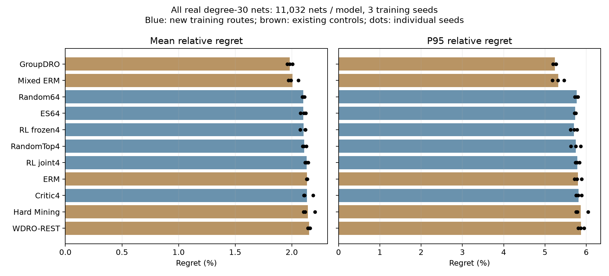

# v3.1 新模型真实数据：验收与统计解读

验收时间：2026-09-13T04:55:48.512980+00:00。结论：**PASS**。

**本轮真实数据上，原有 GroupDRO 的总体 mean、P95 和设计宏平均均最低；新增路线没有取得总体领先。新增路线内部，Random64 的 mean 最低，RL frozen4 的 P95 最低；ES64 的总体 mean 与 Random64 无明确差异。**

## 验收范围和证据

- 18 个新增 best Actor + 15 个原有对照，共 33 个模型；每模型 11,032 条网络，364,056 次预测。
- 新增模型仅训练了 degree=30，所有结果也仅适用于 degree=30。现有 49 个设计均进入覆盖表，43 个含可用网络。
- 原自动流水线于 2026-09-12 18:56:17 UTC 完成。本次为事后重新验收和统计解读，新增 GPU 推理和 GeoSteiner 求解均为 0。
- 重新核验 1,645 项绑定、全部模型 checkpoint、输入/双尺度参考、逐网树连通性和独立线长、1,452 个分片及发布预测一致性。
- 33 个工作进程及 queue、finish、pipeline 共 36 个进程全部退出，36 把锁均可获取并已释放；无重试或未提交评分。
- 独立从逐网结果复算 1,848 行逐种子统计、616 行种子平均、952 行配对置信区间；原统计 CSV 重新生成后逐字节一致。原冻结代码、协议、模型和结果均未改动。
- 正式流水线曾在 GPU 2/3/4/5 上最多 32 进程并发，队列耗时 39.29 秒，含统计验收的流水线耗时 54.30 秒。此耗时复用了已生成的参考缓存，不包含下载、开发、预处理和之前求解参考值的成本。

## 总体统计

relative regret = (REST 线长 − GeoSteiner 最优线长) / 最优线长，越低越好。表中以百分数表示：2.10% 意为平均相对最优值超出约 2.10%，不是错误率。每个种子独立计算后取三种子的算术平均，P95 同样先分种子计算。

| 方法 | 类型 | mean | P95 | 设计宏平均 |
|---|---|---:|---:|---:|
| GroupDRO | 原有对照 | 1.9833% | 5.2430% | 1.5190% |
| Mixed ERM | 原有对照 | 2.0078% | 5.3185% | 1.5413% |
| Random64 | 新增 | 2.1024% | 5.7676% | 1.5418% |
| ES64 | 新增 | 2.1030% | 5.7306% | 1.5487% |
| RL frozen4 | 新增 | 2.1044% | 5.7009% | 1.5579% |
| RandomTop4 | 新增 | 2.1108% | 5.7477% | 1.5625% |
| RL joint4 | 新增 | 2.1312% | 5.7856% | 1.5664% |
| ERM | 原有对照 | 2.1349% | 5.7953% | 1.6049% |
| Critic4 | 新增 | 2.1357% | 5.8145% | 1.5728% |
| Hard Mining | 原有对照 | 2.1430% | 5.8626% | 1.6071% |
| WDRO-REST | 原有对照 | 2.1534% | 5.8737% | 1.6116% |

Random64 相对 ERM 的平均 regret 降低 1.52%，绝对差为 -0.03250 个百分点。这是 regret 的相对降幅，不是所有网络原始线长降低 1.52%。

## 新方法相对 ERM：改善幅度、区间和设计拆分

差值为新方法减 ERM，单位为 regret 百分点，负值有利于新方法。区间采用 2,000 次设计家族聚类 bootstrap；所有三个训练种子保持配对。胜/负按每个设计的三种子平均 mean 比较，不等于显著改善设计数。

| 方法 | 总体 mean 差值 | 95% CI | 改善/持平/变差设计数 |
|---|---:|---|---:|
| RandomTop4 | -0.02413 | [-0.03503, -0.01171] | 31/0/12 |
| Critic4 | 0.00076 | [-0.00949, 0.01347] | 27/0/16 |
| RL frozen4 | -0.03047 | [-0.04327, -0.01450] | 33/0/10 |
| RL joint4 | -0.00376 | [-0.01512, 0.00604] | 28/0/15 |
| Random64 | -0.03250 | [-0.04109, -0.02170] | 31/0/12 |
| ES64 | -0.03190 | [-0.04073, -0.02098] | 32/0/11 |

RandomTop4、RL frozen4、Random64 和 ES64 的总体 mean 对 ERM 有负向区间；Critic4 和 RL joint4 的总体 mean 区间包含零。换成设计宏平均后，RL joint4 对 ERM 的区间为负，说明网络加权与设计等权回答的是不同问题。不能只选对某方法有利的聚合口径。

## 学习型生成器是否带来额外价值

| 比较 | 总体 mean 差值（百分点） | 95% CI（百分点） |
|---|---:|---|
| Critic4 − RandomTop4 | 0.02489 | [0.01250, 0.04026] |
| RL frozen4 − RandomTop4 | -0.00634 | [-0.01666, 0.00659] |
| RL joint4 − RandomTop4 | 0.02037 | [0.00463, 0.03295] |
| RL joint4 − RL frozen4 | 0.02671 | [0.00712, 0.04434] |
| ES64 − Random64 | 0.00060 | [-0.00659, 0.00883] |

Critic4 相对 RandomTop4、RL joint4 相对 RandomTop4/冻结 RL 的总体 mean 均变差；这些比较的设计宏平均区间包含零。因此结论限于本轮网络加权总体指标，不能写成所有设计均变差。RL frozen4 未明确超过 RandomTop4，ES64 未明确超过 Random64。
新增模型均从对应种子的 ERM 继续训练。六路训练更新数一致，但内层真实评分预算及 Critic/RL 的额外学习成本不同；与原有五方法的比较是已交付模型的外部表现比较，不是严格计算量匹配的训练消融。原 A 实验的 Critic/RL 攻击器不是新增 REST 求解器，也不作为这里的 18 个 Actor 重复计数。

## 数据集拆分与 CircuitOps

| 数据集 | 合法 degree=30 网络数 | 有效设计数 | 占全部网络 | mean 最低方法 | P95 最低方法 |
|---|---:|---:|---:|---|---|
| circuitops_asap7 | 65 | 3 | 0.59% | Critic4 | WDRO-REST |
| circuitops_nangate45 | 79 | 4 | 0.72% | RandomTop4 | ES64 |
| circuitops_sky130hd | 2 | 1 | 0.02% | Random64 | Random64 |
| ispd2008_global_routing | 9088 | 16 | 82.38% | GroupDRO | GroupDRO |
| ispd2018_protocol_a | 468 | 10 | 4.24% | GroupDRO | GroupDRO |
| ispd2019_protocol_a | 1330 | 9 | 12.06% | GroupDRO | GroupDRO |

**ISPD2008 占 82.38% 的网络，明显主导总体 mean；CircuitOps 只有 146 条网络（1.32%）、8 个有效设计、5 个家族。** SKY130HD 子集仅 2 条网络，单独排名和 P95 不具备稳定推广依据。

以下是本次新增的 CircuitOps 合并统计（探索性补充，保留原有全部表格）。

| 方法 | CircuitOps mean | CircuitOps P95 | 设计宏平均 |
|---|---:|---:|---:|
| ES64 | 1.2035% | 2.9610% | 1.1468% |
| RL joint4 | 1.2188% | 2.9843% | 1.1588% |
| Random64 | 1.2241% | 3.1828% | 1.1342% |
| RandomTop4 | 1.2335% | 3.1419% | 1.2013% |
| Critic4 | 1.2344% | 3.0225% | 1.1614% |
| ERM | 1.2561% | 3.2395% | 1.3195% |
| Hard Mining | 1.2597% | 3.4028% | 1.2551% |
| WDRO-REST | 1.2692% | 3.1854% | 1.2802% |
| RL frozen4 | 1.2723% | 3.3660% | 1.1974% |
| GroupDRO | 1.2855% | 3.3609% | 1.1490% |
| Mixed ERM | 1.3085% | 3.2085% | 1.2940% |

CircuitOps 合并后 ES64 的 mean/P95 点估计均最低；相对 ERM 的 mean 差为 -0.05257 个百分点，95% CI [-0.11967, -0.02885]。但 ES64 对 GroupDRO 的区间包含零，且只有 5 个设计家族，属于需要更多独立设计验证的探索性信号。

所有 CI 均未作多重比较校正；原表按预定对照生成，本次 CircuitOps 合并及对 GroupDRO/Mixed ERM 的额外区间明确标为事后探索性。区间条件于本轮三个固定训练种子，主要反映设计家族重采样的不确定性，不覆盖任意训练随机性。P95 排名为描述统计，没有以 mean CI 代替 P95 显著性检验。

无合法 degree=30 样本的设计：ispd19_test4、circuitops_asap7_uart、circuitops_nangate45_ariane133、circuitops_nangate45_gcd、circuitops_nangate45_ibex、circuitops_nangate45_jpeg。

## 结果可支持的研究表述

在当前固定 degree=30、合成数据训练后零样本真实坐标测试中，部分新增路线相对 ERM 小幅改善，但没有稳定超越更简单候选生成基线，亦未取得全部真实数据总体最优。ES 在 CircuitOps 小样本上显示有利信号；总体结果不足以证明更强内层攻击自然转化为更好求解模型。
本轮是未受新对抗扰动的真实坐标测试，没有重新运行独立攻击，因此不据此否定或证明既有对抗鲁棒性结论，也不产生 Wasserstein 鲁棒证书。CircuitOps 表示公开芯片物理实现，并不意味着全部已流片。

## 文件入口

- [本次独立验收凭证](acceptance.json)及[文件哈希清单](artifact_bindings.json)。
- [原自动完整报告](../REPORT.md)、[原统计表](../tables/metrics_seed_mean.csv)、[原配对区间](../tables/paired_family_ci.csv)。
- [本次新增合并统计](additional_group_statistics.csv)、[事后探索性配对区间](additional_exploratory_ci.csv)、[逐设计胜负](design_win_loss.csv)。
- [可导出统计图 PDF](overall_statistics.pdf)。
