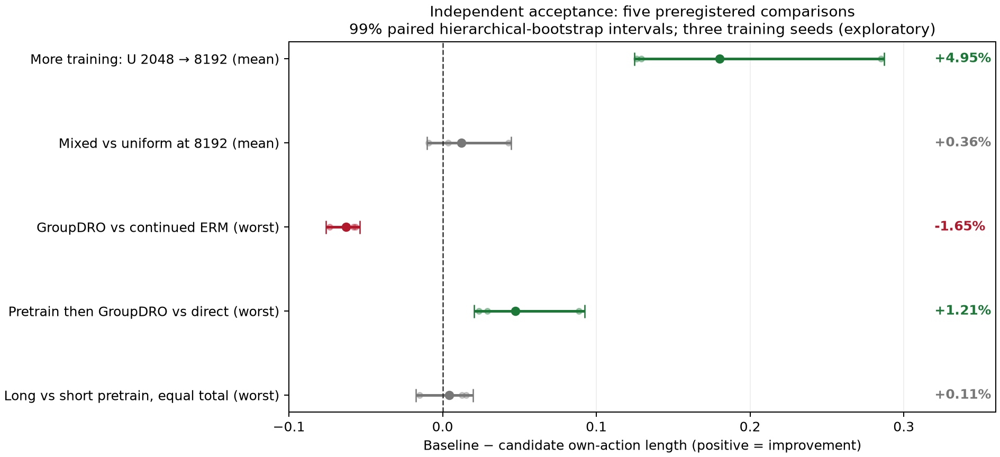

# 纯 RL 训练规模实验：独立验收报告

**验收通过：`PASS_FOR_FROZEN_THREE_SEED_EXPLORATORY_PROTOCOL`。** 工程执行与数值有效性通过；科学结论限定于 degree30、三个种子和本次冻结的合成数据协议。

核心结论：扩大基础训练预算确实改善了本轮结果，支持“训练不足是旧结果的原因之一”。相同总预算下，先做等权预训练再做 GroupDRO 优于直接 GroupDRO；但继续 ERM 在本轮比 GroupDRO 后训练更好。没有证据把全部历史差距归因于训练量或 GeoSteiner 的有无。

## 1. 工程与数据验收

|检查|独立核验结果|
|---|---|
|任务完整性|18/18 训练，18/18 新测试，36 个成功退出；另有1次资源准入延后，无训练重跑|
|耗时|2026-09-21T18:04:37.274255+00:00 至 2026-09-22T02:01:38.102341+00:00，队列墙钟 7.9502 小时；训练 worker 合计 47.8739 小时，测试 worker 合计 0.6018 小时|
|哈希|核对 747 项绑定，涉及 512 个独立文件；验收结束再次核对全部输入未变|
|生命周期|核验 73 个正式进程身份已退出、45 个锁已释放；延后尝试的 wrapper 也已退出|
|资源|准入三次利用率≤35%、空闲显存≥8GiB；实验内GPU和CPU分配无时间重叠|
|训练预算|完整核对 135,168 步；新增 8,650,752 sampled 和 8,650,752 rollout 评分；无未完成调用、无重放|
|验证/测试评分|验证 2,260,992 行；测试 1,572,864 行，96 个固定端点或选中模型|
|独立数值复算|检查连通树拓扑并重算 1,720,320 条自身线长；与保存数组最大差 0.0|
|权重谱系|3个随机初始化可重建；12次父checkpoint的Actor（含BatchNorm）、Adam、RNG逐项相等|
|数据配对|全部对应训练步的四分布批次哈希匹配；另外重新生成24批输入核对哈希|
|数据隔离|验证/测试24,576个net无重复，训练probe无重合；训练进程禁止打开测试文件，调用账本无测试评分|
|测试时序|最后训练结束 2026-09-22T01:53:17+00:00；第一笔测试评分 2026-09-22T01:53:31+00:00；所有测试选择清单绑定全部18个已完成训练|
|选模与目标|完整复核每512步验证、最坏组最小及均值退化容忍规则；GroupDRO始终用历史组权重，更新与记录一致|
|依赖|冻结的奖励与策略代码无外部构造求解器调用；oracle计数为0。独立验收仅CPU读取产物，没有新训练、推理或GPU调用|

审核没有修改训练源码、协议、checkpoint、原始日志或原始自动报告。独立实现见 [verify.py](verify.py)，逐项凭证见 [audit.json](audit.json)、[verify.log](verify.log) 与 [input_hashes.json](input_hashes.json)。数据probe不是对所有历史训练坐标逐net重新枚举，完整配对检查以逐步批次哈希为证据。

## 2. 五项预注册比较与一项补充分析

以下均为相同新测试集上的固定预算端点。改善=(基线−候选)/基线；正数表示线长下降。主要比较的99%区间来自5000次种子及net配对的双层bootstrap，对五项比较采用Bonferroni名义族覆盖95%。独立重算与原报告数值一致（核对容差1e-10）。

|比较|指标|基线→候选|相对改善|绝对改善99%区间|改善种子|判断|
|---|---|---|---:|---|---:|---|
|基础训练量：U 2,048→8,192|平均|3.642028 → 3.461860|+4.947%|[0.124810, 0.287077]|3/3|达到预注册探索支持标准|
|数据覆盖：M8,192 vs U8,192|平均|3.461860 → 3.449511|+0.357%|[-0.010320, 0.044721]|2/3|尚未确立收益|
|稳健后训练：MG12,288 vs ME12,288|最坏组|3.804226 → 3.866967|-1.649%|[-0.075983, -0.053837]|0/3|候选更差，区间完全为负|
|顺序：MG12,288 vs D12,288|最坏组|3.914142 → 3.866967|+1.205%|[0.020385, 0.092265]|3/3|达到预注册探索支持标准|
|阶段分配：MG12,288 vs SG12,288|最坏组|3.871225 → 3.866967|+0.110%|[-0.017446, 0.019873]|2/3|尚未确立收益|
|后训练延长：SG6,144→12,288|最坏组|4.025517 → 3.871225|+3.833%|[0.101604, 0.233266]|3/3|补充探索，未纳入五项主要检验|

“支持”的阈值仍是冻结协议：改善≥0.5%、至少2/3种子改善、校正区间下界>0；稳健后训练还要求均值恶化≤1%。MG 相比 ME 的均值反而恶化 **2.014%**，因此也没有满足该条件。

原自动报告将所有未达到正向标准的比较统一写为“本预算下尚未确立”。本验收补充更明确的解释：MG 对 ME 不是单纯区间跨零，而是三个种子均更差，校正区间全负。这是报告解释的细化，数值不需要更正。

## 3. 固定端点和验证选模结果

U=uniform ERM；M=四分布 ERM 预训练；D=直接 GroupDRO；ME=M8192 后继续 ERM；MG=M8192 后 GroupDRO；SG=M2048 后 GroupDRO。均值为四组等权、再平均三个种子；最坏组先对每个模型取四组最大均值，再平均种子。P95先在每个模型的16,384个测试net上取95%分位，再平均种子。

|路线|checkpoint|均值|最坏组|P95|三个种子的选模步数|
|---|---|---:|---:|---:|---|
|U|best|3.451564|3.890258|4.144285|[7680, 7680, 8192]|
|U|step8192|3.461860|3.917575|4.167719|[8192, 8192, 8192]|
|M|best|3.449173|3.886441|4.143833|[8192, 6656, 8192]|
|M|step8192|3.449511|3.897654|4.150309|[8192, 8192, 8192]|
|D|best|3.537914|3.889851|4.196601|[12288, 11776, 11776]|
|D|step12288|3.560666|3.914142|4.224962|[12288, 12288, 12288]|
|ME|best|3.382385|3.804226|4.050476|[12288, 12288, 12288]|
|ME|step12288|3.382385|3.804226|4.050476|[12288, 12288, 12288]|
|MG|best|3.425562|3.845863|4.101939|[10752, 11264, 9216]|
|MG|step12288|3.450490|3.866967|4.135067|[12288, 12288, 12288]|
|SG|best|3.508907|3.871225|4.176002|[12288, 12288, 12288]|
|SG|step12288|3.508907|3.871225|4.176002|[12288, 12288, 12288]|

**本轮冻结方案中，ME 的测试均值和最坏组均最低**：四分布等权预训练8,192步，再继续ERM4,096步。它的三个验证最佳checkpoint都在12,288步。该排名是本轮观察，不把跨方案测试排名当作新的确认性试验。

描述性预算曲线：
- U：step4096→step8192，测试平均线长下降 1.522%，三个种子均改善。
- M：step4096→step8192，测试平均线长下降 1.952%，三个种子均改善。
- ME：step8192→step12288，测试平均线长下降 1.946%，三个种子均改善。

这说明增加训练仍有价值，但不保证未来按相同速度改善，也没有确立充分训练后的误差下限。ME延长训练同时跨过预设学习率阶段，不能把这部分收益完全拆解成更新次数的独立效应。

## 4. GroupDRO权重与解释边界

9个 GroupDRO 运行的终点 `edge_bias` 权重范围为 **99.97378%–99.9999988%**，其余分布的权重接近零。逐步复算确认这符合冻结的原始线长乘法权重更新，不是使用当前批次新权重回传的实现错误。详见 [group_weights_final.csv](group_weights_final.csv)。

该现象与“原始长度混入各组固有难度、权重可能高度集中”的事前预警一致，可以作为后续机制消融的线索；尚不能据此证明权重集中就是退化的唯一原因。不要在本次测试之后修改η、加权重下限或换目标，再沿用本次测试作盲测。

结论限于三种子探索。三个种子全部同向也不足以构成大量独立训练重复；例如仅对3/3方向一致做精确双侧符号检验，p=0.25。bootstrap区间与预注册门槛在这里用于冻结的探索性判断，不能代替更多训练种子的确认。

本轮没有使用最优参考，因此指标是自身拓扑 REST span 线长，不是真实最优相对误差；没有重新评测 DAC21 主线、真实芯片或连续Wasserstein最坏风险，不能声称已追平旧主线或证明学习型WDRO优于ERM。长/短预训练同总预算的最坏组差异只有0.110%且区间跨零，不能写成“预训练越长越好”。

## 5. 验收产物

- [机器验收结论](audit.json)、[最终交付核查](final_delivery_checks.json)、[输入SHA256](input_hashes.json)。
- [独立统计](statistics_independent.json)、[逐组指标](metrics_independent.csv)、[预算与耗时](runtime_and_calls.csv)、[模型摘要](model_summary.csv)。
- 比较图：[PNG](primary_comparisons.png)、[SVG](primary_comparisons.svg)、[PDF](primary_comparisons.pdf)。
- [原始训练曲线](../report/learning_curves.png)与[原自动报告](../report/REPORT.md)保留不变。

本次验收已完成，未启动额外实验。
