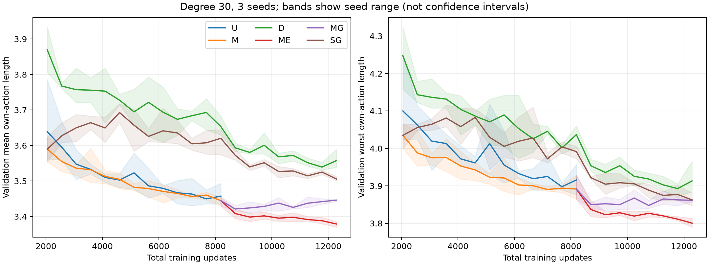

# 纯 RL 扩大训练：自动数值核验与结果

完成于 2026-09-22T02:01:37Z。18 个训练、18 个新测试任务均完成；独立线长重算、哈希、预算及运行锁核验通过。

三种子探索实验，不能证明普遍优越或最优性；原始 span 线长不是相对最优 regret。

|主要比较|相对改善|配对99%区间（绝对线长）|改善种子|判断|
|---|---:|---|---:|---|
|延长 uniform 基础训练|4.947%|[0.124810, 0.287077]|3/3|达到预注册支持标准|
|扩大数据覆盖|0.357%|[-0.010320, 0.044721]|2/3|本预算下尚未确立|
|稳健后训练|-1.649%|[-0.075983, -0.053837]|0/3|本预算下尚未确立|
|预训练顺序|1.205%|[0.020385, 0.092265]|3/3|达到预注册支持标准|
|短/长预训练分配|0.110%|[-0.017446, 0.019873]|2/3|本预算下尚未确立|
|延长后训练（补充）|3.833%|[0.101604, 0.233266]|3/3|补充探索|

延长基础训练达到预注册改善标准，支持训练不足是旧结果的一个原因；仍不能解释全部历史差距。

所有路线均使用自身动作线长，无外部求解器/最优标签。五项主要比较的99%区间使用Bonferroni名义族覆盖；三种子限制仍然存在。

新增 8,650,752 条 sampled 轨迹，等量 committed rollout；实际重放 0 条 sampled。checkpoint 累计训练进程时间 47.83 小时。调度器有退出记录的实际训练 worker 尝试合计 47.87 小时（小型夹具没有调度器计时；缺失或丢失进程的时间不推算）。这些都不能当作队列墙钟时间。

逐组均值/P95：metrics.csv；完整预算：training_budget.csv；逐比较区间：comparisons.csv。
