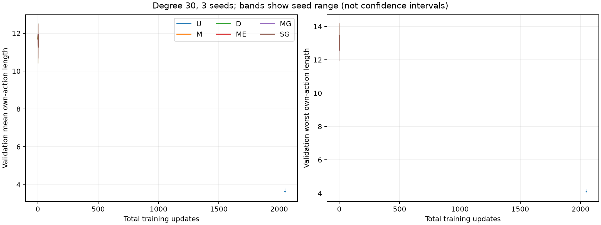

# 纯 RL 扩大训练：自动数值核验与结果

完成于 2026-09-21T18:04:18Z。18 个训练、18 个新测试任务均完成；独立线长重算、哈希、预算及运行锁核验通过。

三种子探索实验，不能证明普遍优越或最优性；原始 span 线长不是相对最优 regret。

|主要比较|相对改善|配对99%区间（绝对线长）|改善种子|判断|
|---|---:|---|---:|---|
|延长 uniform 基础训练|0.164%|[-0.002417, 0.015660]|2/3|本预算下尚未确立|
|扩大数据覆盖|-226.470%|[-9.037979, -7.609269]|0/3|本预算下尚未确立|
|稳健后训练|0.025%|[-0.003104, 0.015399]|2/3|本预算下尚未确立|
|预训练顺序|0.210%|[-0.020008, 0.112755]|2/3|本预算下尚未确立|
|短/长预训练分配|-0.104%|[-0.067625, 0.041731]|1/3|本预算下尚未确立|
|延长后训练（补充）|4.209%|[0.304267, 0.872511]|3/3|补充探索|

本次尚未按预注册标准确立延长基础训练的收益。需结合逐种子曲线区分平台期、种子不确定性和退化，不能直接断言训练规模无效。

所有路线均使用自身动作线长，无外部求解器/最优标签。五项主要比较的99%区间使用Bonferroni名义族覆盖；三种子限制仍然存在。

新增 2,880 条 sampled 轨迹，等量 committed rollout；实际重放 0 条 sampled。checkpoint 累计训练进程时间 0.07 小时。调度器有退出记录的实际训练 worker 尝试合计 0.00 小时（小型夹具没有调度器计时；缺失或丢失进程的时间不推算）。这些都不能当作队列墙钟时间。

逐组均值/P95：metrics.csv；完整预算：training_budget.csv；逐比较区间：comparisons.csv。
