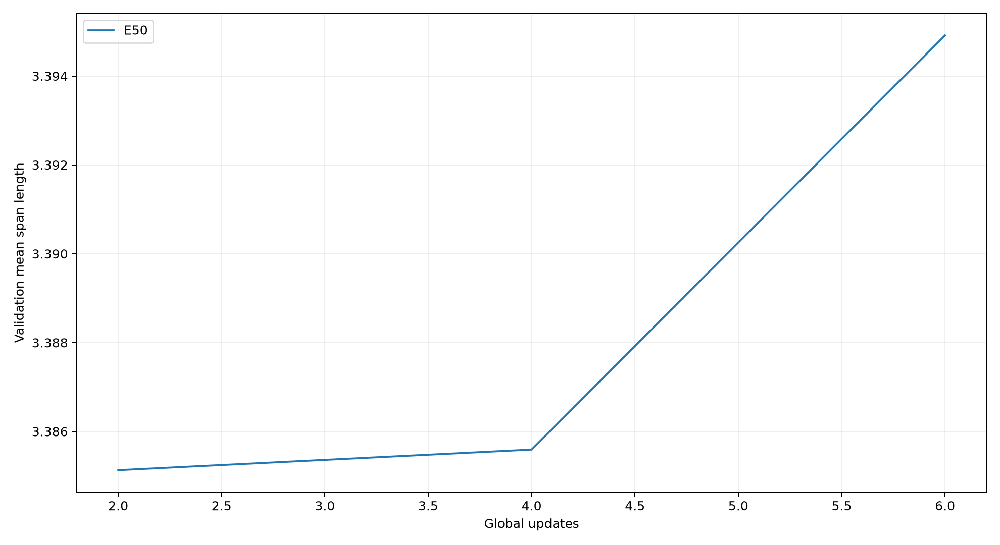

# 纯RL扩展：自动验收报告

状态：PASS_FOR_PREREGISTERED_EXPLORATORY_EXPANSION。工程/数值检查通过，结论限于本次协议。

完成18个训练任务、34个测试任务；新增50次更新、3,200条采样轨迹。

所有筛选方案（含负结果）见models.csv；预算匹配请结合training_budget.csv和理论方案，batch与模型容量比较不能只看步数。
测试在全局训练/选模冻结后打开；各个统计槽使用99%双侧区间，五槽名义族覆盖95%。小种子数及验证选择仍限制结论。

|预注册比较|相对改善|99%绝对改善区间|改善种子|达到探索门槛|
|---|---:|---|---:|---|
|budget_mean|-2.013%|[-0.2794627367448993, 0.055786419138118354]|1/3|False|
|budget_worst|-2.461%|[-0.3244299230615919, 0.05397578609020763]|1/3|False|
|architecture_winner|+13.335%|[0.4995742689096369, 2.8846108145639304]|2/2|True|
|promoted_mean_winner|未晋级|||不提出结论|
|promoted_worst_winner|未晋级|||不提出结论|

degree20/40为探索性跨规模迁移，使用相同模型权重、单次贪心，无新训练。原始长度不是最优相对误差，也不是连续Wasserstein证书。

